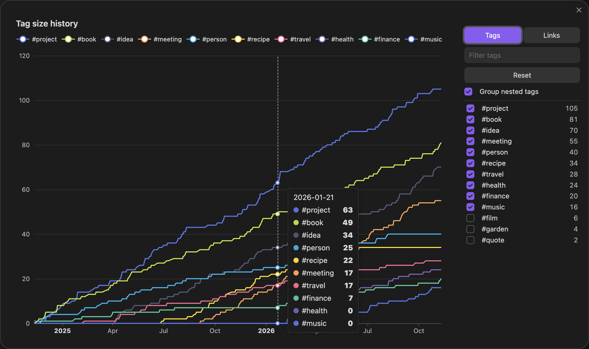
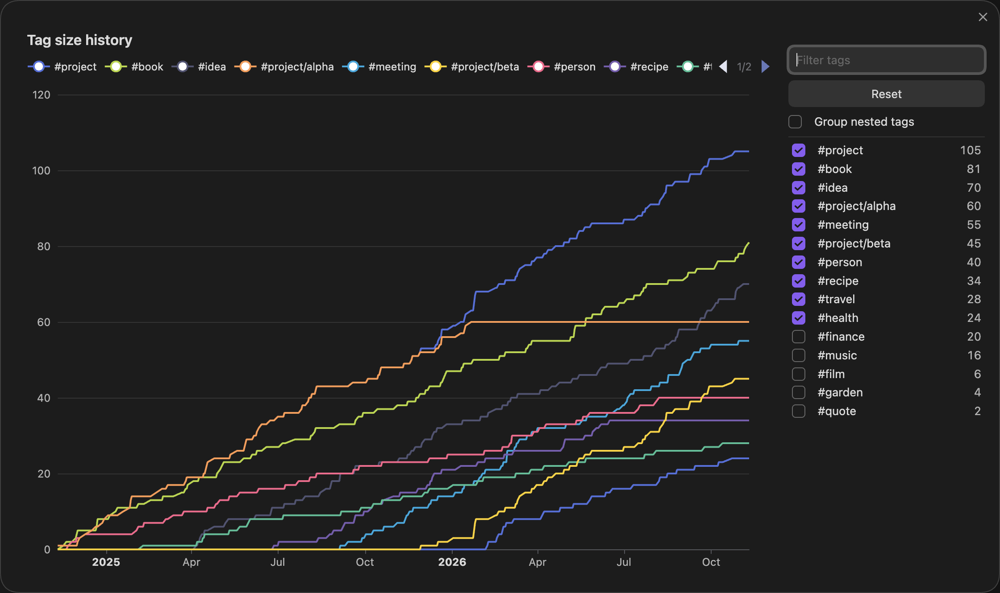

# Tag Size History

See how your tags have grown. Tag Size History is an Obsidian plugin that draws one line per tag, showing how many notes carry that tag over time. It is inspired by [Vault Size History](https://github.com/technerium/obsidian-vault-size-history) by Technerium.



## Using it

Click the chart icon in the ribbon, or run **Tag Size History: Open chart** from the command palette.

- The chart starts with your ten largest tags.
- Hover to see every tag's note count on that date.
- Use the panel on the right to switch any tag on or off. Type in the box to filter the list. Your choices are remembered. **Reset** goes back to the largest tags.
- **Group nested tags** decides how `#project/alpha` is counted. On, it counts toward `#project` only. Off, it also gets a line of its own.



## Settings

| Setting | What it does | Default |
| --- | --- | --- |
| Date source | The date from which a note counts toward its tags: when it was created, when it was last modified, or a date in a frontmatter property. | Created |
| Frontmatter property | The property that holds the date, when the date source is a frontmatter property. A note without a date there uses its creation time. | `created` |
| Number of tags | How many of the largest tags the chart shows. | 10 |
| Group nested tags | Count nested tags toward their top-level tag only. | On |

## How the history is worked out

The plugin does not record anything over time. Each time you open the chart, it reads every note's tags and date, and counts a note toward its tags from that date onward. So the full history is there the first time you open it.

This has two limits:

- It cannot know when a tag was added to a note. A tag added last week to a note from 2022 counts from 2022.
- Deleted notes are not counted.

If file creation times in your vault are wrong, for example after copying the vault or syncing it to a new machine, put the date in a frontmatter property and set **Date source** to **Frontmatter property**.

## Installing

Needs Obsidian 1.13 or later.

The plugin is not in the community list. To install it by hand, build it and copy it into a vault:

```bash
npm install
scripts/deploy.sh /path/to/your/vault
```

Then turn on **Tag Size History** under Settings, Community plugins.

## Development

```bash
make setup            # install and enable the git hooks
make check            # format, lint, types, dead code, boundaries, layout, tests, build
make obsidian-check   # run the plugin in a real, throwaway Obsidian
```

`DESIGN.md` says what the plugin does, `AGENTS.md` has the rules of the repo, and `docs/decisions/` records how and why.

## Credit

Tag Size History takes its idea and the look of its chart from [Vault Size History](https://github.com/technerium/obsidian-vault-size-history) by [Technerium](https://technerium.com), which graphs the number of files in a vault over time. This plugin does the same for tags. It shares no code with Vault Size History.

## Licence

MIT
